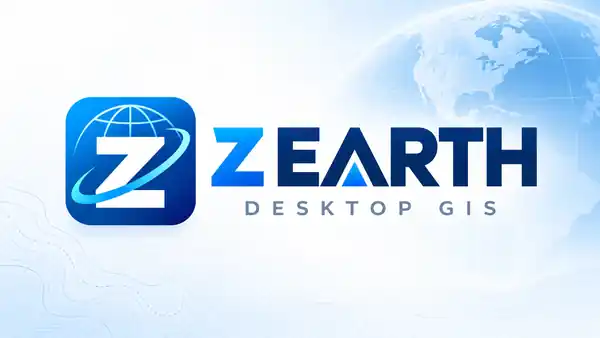

<p align="center">
  
</p>

# Z EARTH — Desktop GIS & 3D Globe

Open-source-oriented **Windows desktop GIS development project** using **.NET 10 WPF / MVVM**, **CesiumJS hosted in WebView2**, **GDAL/PROJ**, **SQLite**, KML/KMZ and geospatial data visualization.

**Current source version:** 2.2.4 (see `src/ZEarth.App/ZEarth.App.csproj`). This number alone is **not evidence of release readiness**. The codebase is undergoing systematic stabilization; successful unit tests alone do not prove that interactive WebView2 globe functions work.

**Developer:** Ahmed Ibrahim. [الدليل بالعربية](README.ar.md) · [Agent guide](AGENTS.md) · [User manual EN](docs/USER_MANUAL_EN.md) · [User manual AR](docs/USER_MANUAL_AR.md) · [Licensing and privacy](LEGAL_AND_PRIVACY_NOTICES.md).

## Download the Windows EXE (Portable Preview)

The GitHub source repository previously **did not publish its compiled .exe**; green Actions builds only uploaded unit-test logs. The [Windows portable preview guide](docs/PORTABLE_PREVIEW.md) now explains how to download the **latest successful main-branch Actions artifact** named `Z-EARTH-v2.2.4-win-x64-portable-preview`, extract it, and launch `Z EARTH.exe` with bundled Cesium assets.

[Open the latest build / download artifacts](https://github.com/ahmadibrahim4geo/Z-EARTH/actions/workflows/build-and-test.yml). The unsigned self-contained **preview** is subject to CI publication/30-day retention; it is not a production GitHub Release. Native Windows GPU/WebView2 checks remain necessary. Existing release notes labelled v1.0.0 are historical and should not be mistaken for the current 2.2.4 source.

## Fresh clone: free prerequisites

- Windows 10/11 x64 and **.NET 10 SDK** for source development.
- Microsoft Edge WebView2 Runtime, GPU/WebGL 2 compatible for interactive globe (test your machine).
- Git and optionally Node.js (for the Cesium JavaScript syntax check). **No ArcGIS or Global Mapper license required**.
- **No paid API key** is required for basic offline mode. Online imagery, terrain and hosted services are subject to the provider's license, fair-use limits, availability and optional token requirements.

```powershell
git clone https://github.com/ahmadibrahim4geo/Z-EARTH.git
cd Z-EARTH
dotnet restore ZEarth.sln
dotnet build ZEarth.sln --configuration Release --no-restore
dotnet test tests/ZEarth.Tests/ZEarth.Tests.csproj --configuration Release --no-build
.\scripts\build-and-test.ps1
```

Launch `dist/Z EARTH-Preview/Z EARTH.exe` **only after** tests and package validation pass. **Single preview policy:** build into a staging folder and replace the single Preview output only after successful validation. See [Windows acceptance checklist](docs/FRESH_CLONE_VALIDATION.md).

## Architecture

| Project path | Role |
| --- | --- |
| `src/ZEarth.App/` | WPF desktop shell, XAML, MVVM commands, settings, project management |
| `src/ZEarth.Globe/` | Bidirectional C# GlobeBridge, packaged CesiumJS/HTML/Workers |
| `src/ZEarth.Domain/` | Geospatial data, CRS/GDAL, KML/KMZ, SQLite, snapping, geometry |
| `tests/ZEarth.Tests/` | Automated unit/component tests; many use **FakeGlobeEngine** |
| `scripts/` | Safe build, Windows screenshot harnesses, reproducibility |
| `.github/skills/` | Project-specialized Z EARTH/CesiumJS skills **and 21 pinned GIS Development Skills** |

## GIS skill integration: new Codex/Agent checkout

Read [AGENTS.md](AGENTS.md) as the first action. The [vendor snapshot](docs/GIS_SKILLS_INTEGRATION.md) copies **21** domain skills and **54** version-pinned references/catalogs with original MIT attribution from [GIS Development Skills](https://github.com/ahmadibrahim4geo/GIS-Development-Skills), **without replacing existing Z EARTH skills**.

The source commit `ef26b76a134b89e950b616e30326df91bd226b43` is recorded in [the checksum manifest](docs/GIS_SKILLS_SNAPSHOT.json). Run `python scripts/validate-agent-skills.py` to verify all copied source Git hashes, local links and XAML before development. The project-specific [Google Earth Pro agent adapter](.github/skills/zearth-google-earth-pro-workflows/SKILL.md) maps [Earth behavior](.github/references/google-earth-pro-engineering.md), [historical imagery design](.github/references/historical-imagery-timeline.md), [KML fidelity](.github/references/google-kml-kmz-compatibility.md) and [World Gazetteer](.github/references/world-gazetteer-reference-layer.md) to real WPF → GlobeBridge → Cesium workflows. The cross-cutting `gis-security-guardian` accompanies the local security specialist.

**New agent workflow:** [Prompt Intent Orchestrator](.github/skills/prompt-intent-orchestrator/SKILL.md) handles scoped, reviewable development plans; [Agent Development Journal](.github/skills/agent-development-journal/SKILL.md) adds optional numbered, private project-local history with real file/test evidence. Both are bundled with runnable offline Python helpers and regression tests. See [Z EARTH agent workflow](docs/ZEARTH_AGENT_WORKFLOW.md). The pin comes from upstream [PR #20](https://github.com/ahmadibrahim4geo/GIS-Development-Skills/pull/20), **still open at the time of integration**, rather than assuming a release on upstream main.

**This integration teaches coding agents working on the repository; the compiled Z EARTH executable does not dynamically execute or interpret SKILL.md.** Existing Esri Wayback dates are **release dates**, not sensor acquisition dates. Source-guided upgrades require actual implementation and native acceptance.

The agent picks the task-specific chain. Example: *Sunlight toggle not working* → `gis-development` router → `gis-desktop-application-development` + `geospatial-web-mapping` → existing `zearth-globe-bridge` and `cesiumjs-terrain-environment` → correct source and acceptance tests.

## Before reporting a feature as fixed

1. **T0:** identify code path and concrete failure.
2. **T1:** syntax/format/static checks pass.
3. **T2:** .NET unit and negative-response tests pass.
4. **T3:** demonstrate actual hardware Windows/WebView2 engine behavior (navigation, basemap, time/lighting, 2D/3D, terrain, KML, save/open).
5. **T4:** install/run the verified portable Preview on a fresh Windows machine.

Newly cloned agents must not conflate T2 with T3/T4. Follow [release evidence checklist](docs/FRESH_CLONE_VALIDATION.md).

## Google Earth Pro parity & engineering roadmap

Our project targets the useful **Google Earth Pro Desktop** workflows (saved camera scenes and ordered My Places, Temporary Places, KML/KMZ, name/coordinate search, 3D terrain, profiles, measurement, drawing, themes, imagery). The [detailed parity matrix](docs/GOOGLE_EARTH_PRO_PARITY.md) separates implemented fixes from still-planned features. Unlike the previous draft, profile elevation is never *fabricated* from sine waves; the current chart is clearly labelled **stored path vertex Z** until true active-DEM sampling is implemented.

**REA tool:** [morluto/rea](https://github.com/morluto/rea) is the existing MIT-licensed local reverse-engineering **analysis tool**, not Google Earth Pro source. The user's `D:\\My Software\\Zearth\\rea` workspace stays outside tracked Z EARTH. We reviewed REA docs but have **not run REA on the user's local Google Earth Pro installation**; refer to [REA task skill](.github/skills/zearth-rea-parity/SKILL.md). No proprietary Google Earth binaries or extracted code are bundled.

## Historical imagery timeline (Esri Wayback)

The **Historical Imagery → Show Timeline** command now opens a **compact nonmodal bar over the 3D globe**, not a blocking Windows dialog. Use **previous/next**, first/latest, the draggable release slider, the year selector or a calendar date. If the selected day is not an actual archive release, the viewer selects the nearest release **on or before** that date. Close (× or Escape in the timeline) to restore the previous basemap. Pan and zoom remain usable while the bar is open.

The slider uses Esri World Imagery Wayback map **release dates** (archive snapshots dating from 2014), not Google Earth Pro's proprietary time series and **not actual satellite acquisition dates**. Imagery and local update coverage vary, and a requested tile is not guaranteed to load. The real Esri release catalog must be available online; no invented fallback dates or paid service keys are used. Esri hosted services have independent terms and attribution. [Implementation and validation details](docs/HISTORICAL_IMAGERY_TIMELINE.md).
## Current limitations

This source review is not a promise that all basemap providers work or every feature is production ready. External tile servers require real connectivity and provider rights, and paid Cesium ion services are **optional**. Windows GPU UI acceptance is required. Build/test CI is only a prerequisite.

## Licensing

See [THIRD_PARTY_LICENSES.md](THIRD_PARTY_LICENSES.md) and [LEGAL_AND_PRIVACY_NOTICES.md](LEGAL_AND_PRIVACY_NOTICES.md). The copied GIS skill texts are MIT-licensed **separately from source projects they reference**. Never bundle proprietary GIS SDKs, cache prohibited tiles or publish personal credentials.

## Development skills source snapshot

Z EARTH vendors a reviewed [GIS Development Skills](https://github.com/ahmadibrahim4geo/GIS-Development-Skills) snapshot: **30 generic specialist skills and 76 references**, pinned to source `main` commit `222699fb04a8d6ea2583f13e5e37dbfc6a0f55cd`. See [integration and reproducible verification](docs/GIS_SKILLS_INTEGRATION.md) and [snapshot hashes](docs/GIS_SKILLS_SNAPSHOT.json). These are development-agent resources; application UI features require separate wiring and real Windows acceptance.
